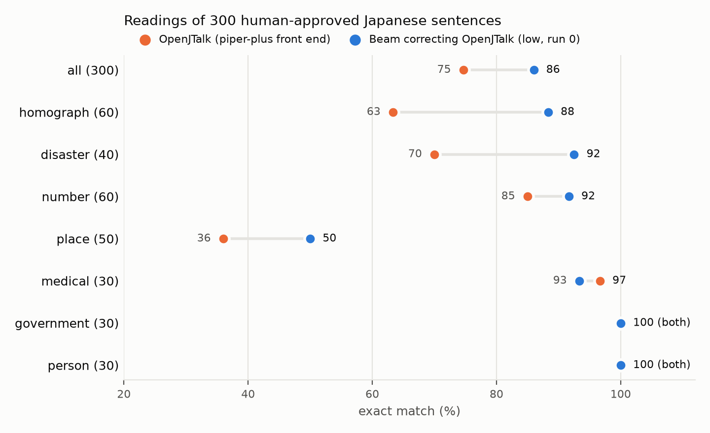

# beam-ja-yomi-bench

**Can Beam fix the misreadings of a Japanese text-to-speech front end?**

Japanese text-to-speech first turns text into a katakana reading, usually with a dictionary-based converter such as
OpenJTalk, and the converter often misreads numbers, units, symbols, words whose reading depends on context, and proper
nouns. This repository measures how well [Beam-1.0-501B-A23B](https://huggingface.co/reflection/Beam-1.0-501B-A23B)
(Reflection AI) reads Japanese text, and how often it fixes, or breaks, OpenJTalk's reading when asked to correct it.

- Dataset: https://huggingface.co/datasets/ayousanz/beam-ja-yomi-bench (300 human-approved sentences in 7 categories)
- Demo: https://huggingface.co/spaces/ayousanz/beam-ja-yomi-fixer (results, examples side by side in kana and romaji, live correction, and speech with piper-plus)

## Results



Exact match over 300 sentences (runs on 2026-10-22 and 2026-10-23). Fixed / broken compare each `beam_fix` run with
`ojt`, which gets 76 sentences wrong and 224 right.

| System | `reasoning_effort` | Runs | Exact match | Mean CER | Fixed / broken | Mean reasoning tokens |
|---|---|---|---|---|---|---|
| `ojt` | — | 1 | 74.7% | 0.042 | — | — |
| `ojt_vanilla` | — | 1 | 73.7% | 0.043 | — | — |
| `beam_direct` | low | 3 | 82.3–84.3% | 0.020–0.023 | — | 289–300 |
| `beam_direct` | low, Japanese prompt | 1 | 80.7% | 0.023 | — | 293 |
| `beam_direct` | medium | 1 | 85.3% | 0.016 | — | 504 |
| `beam_direct` | high | 1 | 84.0% | 0.018 | — | 592 |
| `beam_fix` | low | 3 | 83.0–86.0% | 0.023–0.054 | 38–45 / 6–13 | 310–345 |
| `beam_fix` | medium | 1 | 86.7% | 0.016 | 46 / 10 | 657 |
| `beam_fix` | high | 1 | 87.3% | 0.044 | 48 / 10 | 852 |

By category (exact match; `low` is run 0):

| Category | `ojt` | `beam_direct` low | `beam_fix` low | `beam_fix` medium | `beam_fix` high |
|---|---|---|---|---|---|
| `homograph` (60) | 63.3% | 85.0% | 88.3% | 86.7% | 86.7% |
| `disaster` (40) | 70.0% | 80.0% | 92.5% | 90.0% | 90.0% |
| `number` (60) | 85.0% | 80.0% | 91.7% | 93.3% | 91.7% |
| `place` (50) | 36.0% | 62.0% | 50.0% | 52.0% | 58.0% |
| `medical` (30) | 96.7% | 90.0% | 93.3% | 100.0% | 100.0% |
| `government` (30) | 100.0% | 96.7% | 100.0% | 100.0% | 100.0% |
| `person` (30) | 100.0% | 96.7% | 100.0% | 100.0% | 100.0% |

What stands out:

- **Correcting OpenJTalk is a little better than reading from scratch** (85.7% against 83.6% on average over the
  English-prompt runs; the ranges overlap), **except for place names.** `beam_fix` fixes half to
  two thirds of OpenJTalk's errors (thousands separators, fractions, 方 read as ホー instead of カタ, 辛い, 最中, 下手 on
  a stage) and breaks 3–6% of the readings that were right. For place names the draft hurts (`beam_fix` 48–58%,
  `beam_direct` 52–64%): OpenJTalk reads the suffix 町 as マチ in 22 of the 26 towns whose reading is チョウ, and Beam
  often keeps it.
- **Higher `reasoning_effort` helps little.** `high` uses about 2.5 times the reasoning tokens of `low` and gains
  1–4 points for `beam_fix`, about the same as the spread between the three `low` runs.
- **Reasoning sometimes leaks into the answer.** In 4 of the 1,500 `beam_fix` outputs (none of the 1,800
  `beam_direct` ones), the answer contains English notes such as "Wait no spaces" or the reading repeated over and
  over. These raise the mean CER of `beam_fix` low runs 0–1 and `high`.
- When Beam fails to fix a sentence, it often returns OpenJTalk's reading unchanged (11 of 31 in `beam_fix` low run 0).

The full report is `results/report.md`, and every per-sentence output is in `results/`.

### Using Beam with a check

Ask Beam twice, once to read the sentence on its own (`beam_direct`) and once to correct OpenJTalk (`beam_fix`), and
take the reading only when the two answers agree; otherwise send the sentence to a person. On the 300 sentences
(`low`, run 0) the answers agree on 229 (76%), and 222 of those (96.9%) are exactly right, against 74.7% for
OpenJTalk alone and 86.0% for `beam_fix` alone. The other 71 go to a person. **This rule was found after looking at
the results, not planned in advance**, so these numbers are optimistic; the dataset card has the details.

## Part 2: Yomi-Distill

Can a small model, trained on Beam's corrections, fix OpenJTalk without calling Beam? Beam read 7,551 Japanese
Wikipedia sentences twice; the 5,515 where its two answers agreed trained `llm-jp/llm-jp-3-1.8b` (LoRA). The
candidates, the selection on a dev set and the bar to pass were pre-registered, and the frozen model was scored once.

**It did not beat OpenJTalk**: 74.7% on the 300 sentences, the same as OpenJTalk (Beam correcting OpenJTalk: 86.0%).
It mostly copies OpenJTalk's reading; on the 300, all of its fixes are reading 町 in place names as チョウ. On 99 new
sentences (readings written by Claude, not checked by a person), when Beam's two answers agreed (67), the reading was
right 65 times (97.0%), which supports the check above.

- Model: https://huggingface.co/ayousanz/yomi-distill-ja
- Teaching data, test sets, pre-registration and results: https://huggingface.co/datasets/ayousanz/beam-yomi-teacher
- Demo: https://huggingface.co/spaces/ayousanz/yomi-distill (code in `space_distill/`)

## What is compared

| System | What it does |
|---|---|
| `ojt` | OpenJTalk as used by [piper-plus](https://github.com/ayutaz/piper-plus): `pyopenjtalk-plus[onnxruntime]==0.4.1.post9`, `g2p(text, kana=True)`, default settings, no user dictionary |
| `ojt_vanilla` | the same with `use_vanilla=True` (reference) |
| `beam_direct` | Beam reads the sentence on its own |
| `beam_fix` | Beam gets the sentence and OpenJTalk's reading, and returns the corrected reading |

Beam runs at `temperature` 0.7, `top_p` 0.99, `max_completion_tokens` 16000, with `reasoning_effort` `low` (3 runs),
`medium` and `high` (1 run each). The prompts are in `yomibench/systems/beam.py`. Scoring normalizes both readings
(NFKC, hiragana to katakana, katakana and ー only, long-vowel spellings unified) and counts exact matches and character
error rate; see the dataset card for the rules.

## Running it

Needs [uv](https://docs.astral.sh/uv/) and Python 3.11 or later.

```bash
uv sync
uv run pytest -q                                   # tests (add --group space for the demo's tests)
uv run scripts/run_eval.py --system ojt            # OpenJTalk on data/yomi.jsonl -> results/ojt.jsonl
```

Beam needs an API key from Reflection AI in `.env` (`REFLECTION_API_KEY=...`). Every response is cached under
`cache/beam/`, so a run that stops at the daily limit (exit code 2) can be resumed the next day without repeating calls.

```bash
uv run scripts/run_eval.py --system beam_fix --effort low --runs 3   # needs results/ojt.jsonl first
sh scripts/run_all.sh results                                        # every condition, then the summary
uv run scripts/summarize.py                                          # results/summary.json and report.md
```

Beam samples at temperature 0.7, so a new run gives new outputs; the published `results/` hold the outputs behind the
numbers above. To run the demo locally: `uv sync --group space`, then `uv run --group space python space/app.py`.

Part 2 (Yomi-Distill) needs a CUDA GPU and the `train` group (PyTorch from the CUDA 12.6 index):

```bash
uv sync --group train --group dev --group space
uv run scripts/build_corpus.py --n 30000                    # Wikipedia sentences, minus those near the 300
uv run scripts/make_fresh_set.py                            # draw the 200 dev/test sentences, exclude them from the pool
uv run scripts/run_teacher.py --limit 12000 --budget-usd 18 # Beam's two readings per sentence (HF_TOKEN in .env)
uv run scripts/sweep_dev.py --freeze                        # train the candidates, choose on dev, freeze
uv run scripts/predict_student.py --model models/<chosen> --items data/yomi.jsonl --out results/distill/eval300/student.jsonl
```

The `dev` and `test` readings (written by Claude and cross-checked by a second Claude reading, not by a person) are
in the Hugging Face dataset (`data/fresh_dev.jsonl`,
`data/fresh_test.jsonl`); put them at `data/fresh/dev.jsonl` and `data/fresh/test.jsonl`.

## Layout

| Path | Contents |
|---|---|
| `data/yomi.jsonl` | the dataset (same as on Hugging Face) |
| `yomibench/` | normalization, metrics, systems, evaluation, summary, demo helpers; Part 2's pool, teacher, student and gate |
| `scripts/` | command-line entry points (sampling place names, review sheet, evaluation, summary, publishing; Part 2's corpus, teacher, training, dev sweep and scoring) |
| `space/` | the Gradio demo of Part 1 |
| `space_distill/` | the Gradio demo of Part 2 (the student on ZeroGPU) |
| `tests/` | tests |
| `results/` | per-sentence outputs, `summary.json`, `report.md` |

## License and credits

- Code: MIT. Dataset: CC BY 4.0. Part 2's model: Apache 2.0 (as llm-jp-3-1.8b). Part 2's teaching data and test sets: from Japanese Wikipedia, CC BY-SA 3.0
  (on Hugging Face).
- Place names: Japan Post postal code data (no copyright claimed by Japan Post).
- Reading converter: [pyopenjtalk-plus](https://github.com/tsukumijima/pyopenjtalk-plus).
- Speech in the demo: piper-plus with the Tsukuyomi-chan voice. Its terms forbid redistributing the synthesized speech
  as material; the demo does not offer downloads.
